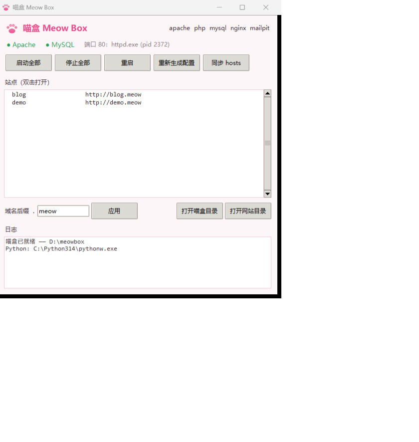

# 🐾 Meow Box（喵盒）

一个轻量的本地 Web 开发环境管家 —— 用来替代 Laragon。

**绿色便携**：不装 Windows 服务、不写注册表，整个文件夹复制到哪个盘都能跑
（细节见 [docs/features.md](docs/features.md) 的「便携」一节）。

喵盒**不自己造轮子**：Apache / Nginx / MySQL / PHP / Mailpit 全是上游官方程序，
喵盒只干四件事：

1. **生成配置** — 把模板渲染成真的 `httpd.conf` / `nginx.conf` / 虚拟主机 / PHP 挂载
2. **看管进程** — 启动、优雅停止各个服务，记录 PID
3. **维护 hosts** — 用成对标记 `# >>> meowbox` / `# <<< meowbox` 圈住自己的条目
4. **下载软件** — 照 `packages.conf` 清单下载解压



### 从源码跑

只需要 **Python 3.10+**，**零第三方依赖** —— 托盘是纯 `ctypes` 调 Win32，
面板是 `tkinter`，图标是纯 Python 画的（连 Pillow 都没用）。只有打包成 exe
那一步才需要 PyInstaller。

推荐用 [uv](https://docs.astral.sh/uv/) 管开发环境 —— 依赖和 Python 版本都锁在
`uv.lock` / `.python-version` 里，换台机器结果也一样：

```bash
git clone https://github.com/ClanceyPRMS/Meow-Box.git
cd Meow-Box
uv sync                        # 建 .venv，按 uv.lock 装好（含打包用的 PyInstaller）
uv run python meowbox.py init  # 生成 meowbox.config.json
uv run python meowbox.py info  # 看看探测到了什么
```

不想装 uv 也行：**运行时一个第三方包都不需要**，直接 `python meowbox.py ...`；
只有打包那一步要 `pip install pyinstaller==6.22.3`。

> **为什么把 Python 钉在 3.14**：托盘用 `ctypes.wintypes.HCURSOR`，某些精简 /
> 嵌入式解释器（比如 IDE 自带的 venv）里没有这个常量，托盘一启动就
> `AttributeError`。`.python-version` 写死 3.14 + `uv sync`，就不用靠记性挑解释器。
> 注意 `requires-python` 写的是 `>=3.10`，那不是拍脑袋：3.10.22 上 `compileall`
> 和全套单测都真跑通过（24 个模块里只有 `tray` 是 Windows 专属、在 Linux 上不 import）。
> 也就是说 **3.10+ 能跑命令行和面板，托盘和打包用 3.14**。

仓库里**只有源码**：二进制（`bin/`）、网站（`www/`）、数据库（`data/`）、
渲染出的配置（`etc/`）、日志（`logs/`）都在 `.gitignore` 里，各自在自己机器上生成。
所以第一次跑之前，得先把 Apache / PHP / MySQL 弄进 `bin/` 下：

- **机器上装过 Laragon** → `python meowbox.py init` 直接借它的二进制，一步到位；
- **没装过** → `python meowbox.py init --provider ""`，然后
  `python meowbox.py pkg install apache php mysql` 从官方源下载原版。

> **Linux 上不一样**：不下载自己的二进制，用发行版的包（见 [docs/linux.md](docs/linux.md)）。

### 跑测试

```bash
uv run python -m pytest        # 或者 pip install pytest && python -m pytest
```

测试只碰**纯逻辑**：模板渲染、hosts 拼接、配置相对化、清单解析、版本号一致性。
不启任何服务，所以 Linux 上也能跑 —— 改 `hosts.py` / `config.py` / `vhost.py`
不必切回 Windows 就能验。GitHub Actions 上跑三个组合：Ubuntu 3.10 / Ubuntu 3.14 /
Windows 3.14（托盘和提权那条路只有真 Windows 能验）。

人工部分测试盖不住，改完自己补两条：

```bash
python meowbox.py render              # 内部会跑 httpd -t / nginx -t
grep -n '@' etc/apache2/httpd.conf    # 占位符不能有残留
```

## 快速开始

```bash
# 1. 初始化（有 Laragon 就借它的 Apache/MySQL/PHP 二进制；
#    没有的话 `init --provider ""`，再用 pkg install 下载）
python meowbox.py init

# 2. 看看探测到了什么
python meowbox.py info

# 3. 生成配置 + 语法自检
python meowbox.py render

# 4. 建站点
python meowbox.py site add blog
python meowbox.py render
python meowbox.py hosts --apply      # ← 要管理员权限的终端

# 5. 起飞
python meowbox.py start all
python meowbox.py status
```

打开 <http://blog.meow> 就能看到了。

## 文档

README 只留「这是什么 + 怎么跑起来」。剩下的都在 `docs/` 里 —— 那是这个项目花时间最多的地方，
每个坑都是真机上踩出来的。

| 文档 | 什么时候该看 |
|---|---|
| [docs/linux.md](docs/linux.md) | 在 Arch / Debian 上装组件、为什么默认端口是 8080/8443、hosts 和证书在 Linux 上存在哪 |
| [docs/features.md](docs/features.md) | 图形界面、HTTPS 小绿锁、Apache ↔ Nginx 切换、PHP 多版本、Mailpit、从 Laragon 迁移、彻底自带、便携搬家、打包 exe、日志清理 |
| [docs/reference.md](docs/reference.md) | 全部命令、目录结构、还没做的事（TODO） |
| [docs/cross-platform.md](docs/cross-platform.md) | 同一个目录两个系统（Windows + Linux）轮着用：换行、`.venv`、数据目录、git 配置 |
| [docs/design-notes.md](docs/design-notes.md) | **为什么这么设计** 和踩过的坑 —— 想改代码先读它，比读代码快 |
| [CONTRIBUTING.md](CONTRIBUTING.md) | 想改代码 / 提 PR（平台改动的硬规矩 + 自查清单） |
| [SECURITY.md](SECURITY.md) | 发现安全问题（走私密报告，别开公开 Issue） |
| [CHANGELOG.md](CHANGELOG.md) | 每个版本改了什么 |

## 更新日志

每个版本改了什么、修了什么、还差什么，见 [CHANGELOG.md](CHANGELOG.md)。

## 许可证

MIT License —— 见 [LICENSE](LICENSE)。拿去用、改、再发布都行，保留版权声明就好。

---

玛莉嘉 & 于光远 · 2026
