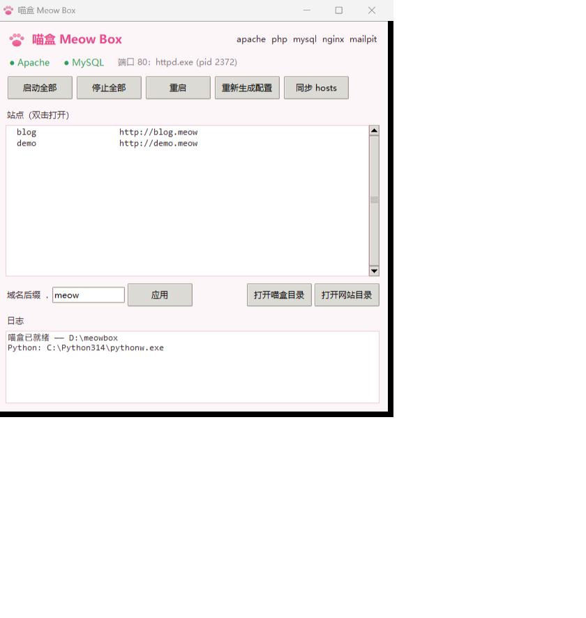

# 🐾 Meow Box（喵盒）

一个轻量的本地 Web 开发环境管家 —— 用来替代 Laragon。

**绿色便携**：不装 Windows 服务、不写注册表，整个文件夹复制到哪个盘都能跑
（细节见下面「便携」一节）。

喵盒**不自己造轮子**：Apache / Nginx / MySQL / PHP / Mailpit 全是上游官方程序，
喵盒只干四件事：

1. **生成配置** — 把模板渲染成真的 `httpd.conf` / `nginx.conf` / 虚拟主机 / PHP 挂载
2. **看管进程** — 启动、优雅停止各个服务，记录 PID
3. **维护 hosts** — 用成对标记 `# >>> meowbox` / `# <<< meowbox` 圈住自己的条目
4. **下载软件** — 照 `packages.conf` 清单下载解压



### 从源码跑

只需要 **Python 3.10+**，**零第三方依赖** —— 托盘是纯 `ctypes` 调 Win32，
面板是 `tkinter`，图标是纯 Python 画的（连 Pillow 都没用）。只有打包成 exe
那一步才需要 PyInstaller。

推荐用 [uv](https://docs.astral.sh/uv/) 管开发环境 —— 依赖和 Python 版本都锁在
`uv.lock` / `.python-version` 里，换台机器结果也一样：

```bash
git clone https://github.com/ClanceyPRMS/Meow-Box.git
cd Meow-Box
uv sync                        # 建 .venv，按 uv.lock 装好（含打包用的 PyInstaller）
uv run python meowbox.py init  # 生成 meowbox.config.json
uv run python meowbox.py info  # 看看探测到了什么
```

不想装 uv 也行：**运行时一个第三方包都不需要**，直接 `python meowbox.py ...`；
只有打包那一步要 `pip install pyinstaller==6.22.3`。

> **为什么把 Python 钉在 3.14**：托盘用 `ctypes.wintypes.HCURSOR`，某些精简 /
> 嵌入式解释器（比如 IDE 自带的 venv）里没有这个常量，托盘一启动就
> `AttributeError`。`.python-version` 写死 3.14 + `uv sync`，就不用靠记性挑解释器。

仓库里**只有源码**：二进制（`bin/`）、网站（`www/`）、数据库（`data/`）、
渲染出的配置（`etc/`）、日志（`logs/`）都在 `.gitignore` 里，各自在自己机器上生成。
所以第一次跑之前，得先把 Apache / PHP / MySQL 弄进 `bin/` 下：

- **机器上装过 Laragon** → `python meowbox.py init` 直接借它的二进制，一步到位；
- **没装过** → `python meowbox.py init --provider ""`，然后
  `python meowbox.py pkg install apache php mysql` 从官方源下载原版。

## 快速开始

```bash
# 1. 初始化（有 Laragon 就借它的 Apache/MySQL/PHP 二进制；
#    没有的话 `init --provider ""`，再用 pkg install 下载）
python meowbox.py init

# 2. 看看探测到了什么
python meowbox.py info

# 3. 生成配置 + 语法自检
python meowbox.py render

# 4. 建站点
python meowbox.py site add blog
python meowbox.py render
python meowbox.py hosts --apply      # ← 要管理员权限的终端

# 5. 起飞
python meowbox.py start all
python meowbox.py status
```

打开 <http://blog.meow> 就能看到了。

## 图形界面

```bash
python meowbox.py shortcut     # 生成两个双击启动器（.vbs，不弹黑框）
python meowbox.py tray         # 启动系统托盘
python meowbox.py gui          # 打开控制面板窗口
python meowbox.py autostart on # 开机自启
```

- **系统托盘**（`tray`）：右键猫爪图标 → 启动/停止全部服务、打开站点、
  打开目录、打开控制面板、重新生成配置、同步 hosts（会自动弹 UAC 提权）、
  开机自启开关、退出。纯 `ctypes` 调 Win32 `Shell_NotifyIcon`，
  **没装任何第三方库**。双击图标 = 打开第一个站点。
- **控制面板**（`gui`）：`tkinter` 写的窗口 —— 服务状态（绿色圆点）、
  站点列表（双击打开）、域名后缀、按钮式操作、日志。
- 双击 `meowbox-tray.vbs` / `meowbox-panel.vbs` 就能启动。
- 图标是自己画的：`python -m meow.icon` 会重新生成
  `assets/meowbox.ico`（多尺寸）和预览图，不用 Pillow。

## HTTPS（自签证书）

```bash
python meowbox.py ssl          # 一键：建 CA → 签证书 → 开 HTTPS → 装信任库
python meowbox.py ssl check    # 体检：一层层查为什么没有小绿锁（缺哪层说哪层）
python meowbox.py ssl list     # 看证书和信任状态
python meowbox.py ssl renew    # 重新签发全部
python meowbox.py ssl trust    # 只把根证书装进信任库
python meowbox.py ssl untrust  # 从信任库移除
python meowbox.py ssl off      # 关掉 HTTPS（证书都保留）
```

### 小绿锁不亮？点「体检」

面板里 HTTPS 状态旁边有个 **体检** 按钮（菜单「工具 → HTTPS 证书 → HTTPS 体检」也有）。
它按真实的故障顺序一层层查，而不是让你自己猜：

| 层 | 查什么 | 典型症状 |
|---|---|---|
| 1 开关 | `web.ssl` 开着吗、端口几号 | 根本没开 HTTPS |
| 2 根证书 | CA 在不在、**装进信任库了吗** | 能开 https 但浏览器红锁 |
| 3 站点证书 | `.crt/.key` 在不在、链验得过吗、SAN 有域名吗、到期没 | 换过后缀/换过 CA 后证书对不上 |
| 4 SSL 虚拟主机 | `sites-enabled/auto.<域名>-ssl.conf` 生成了吗 | **换过 TLD 最容易漏**：证书还停在旧后缀 |
| 5 端口 | 443 是谁在听、是不是当前 Web 服务器 | 被别的程序占了 |
| 6 **真握手** | 带 SNI 真握一次，把服务器递过来的证书 CN 跟域名比 | 抓到「443 上其实是明文 HTTP」这种光看配置看不出来的 |

第 6 层是关键：如果 443 落脚到普通 HTTP 站点（没有 SSL 虚拟主机），
TLS 客户端收到的是 HTTP 明文响应，OpenSSL 报 `packet length too long`，
curl 报 `SEC_E_INVALID_TOKEN` —— 体检会直接说「拿到的是明文 HTTP 响应」，
而不是让你去怀疑证书或 DLL。

发现问题时窗口底下有 **一键修复**（重签全部证书 → 重生成配置 → 重启），
点一下就走完整条链路，然后再点「重新体检」确认全绿。

装完 `https://blog.meow` 就是**小绿锁**。原理（跟 mkcert 一样）：

1. 生成一张只属于这台机器、10 年有效的根证书（CA）
2. 用它给每个站点签**带 SAN** 的证书（现代浏览器只看 SAN，不看 CN）
3. 把根证书装进**当前用户**的信任库（`certutil -addstore -user Root`，**不需要管理员**）
4. 打开 `web.ssl` → Apache 监听 443，并为每个站点生成 SSL 虚拟主机

证书都在 `etc/ssl/`：`meowbox-ca.crt` 是根证书，`sites/<域名>.crt|.key` 是站点证书。
不想要了就 `ssl untrust` + `ssl off`，根证书随时能删。

> Firefox 默认会读 Windows 信任库；如果它自己建了库，去
> `about:config` 把 `security.enterprise_roots.enabled` 设成 `true`。

## Web 服务器：Apache 还是 Nginx

喵盒**同一时间只跑一个** Web 服务器（两个都想占 80 端口），随时能换：

```bash
python meowbox.py web            # 看现在用的是哪个
python meowbox.py web nginx      # 换成 Nginx（会先停掉正在跑的 Apache）
python meowbox.py web apache     # 换回来
python meowbox.py start          # 之后 start/stop/status 管的都是它
```

换的时候会自动：停掉另一个 → 改 `web.server` 和 `autostart` → 渲染新配置 →
语法自检。**自检不过就原样退回**，不会给你留一个起不来的环境。

两个服务器的行为基本一致：站点 `<名字>.meow`、HTTPS、日志都照旧。
唯一要注意的是 **`.htaccess` 只有 Apache 认** —— 用 Nginx 时把重写规则写成
`try_files` / `location`（喵盒的模板里已经带了 `try_files`）。

**Nginx 的 PHP 是怎么跑的**：Nginx 自己不解释 PHP，喵盒会另外拉起 `php-cgi.exe -b 127.0.0.1:9000`（FastCGI）。
`start nginx` 会把这一对一起起来，`stop` 一起收掉；端口嫌挤就在配置里改
`php.fastcgi_port`。改完配置不用重启：`render` 会自动 `nginx -s reload` 热加载，
连接都不带断的。

装了多个 PHP 版本时，**每个版本各起一个 php-cgi**（端口见 `php list`），
站点用它自己指定那个版本 —— 详见下一节。

## PHP：多版本 + 站点级切换

`bin/php/` 下面放几个版本就是几个版本，喵盒自己扫，不用登记：

```bash
python meowbox.py php list               # 装了哪些、默认是哪个、各占哪个端口
python meowbox.py php install 8.5        # 从 php.net 下 Windows x64 线程安全包
python meowbox.py php use 8.5            # 换默认版本（没单独指定的站点都跟着它）
python meowbox.py php site blog 8.5      # 只让 blog 用 8.5
python meowbox.py php site blog default  # 让它跟回默认版本
python meowbox.py php ini                # 打开默认版本的 php.ini
python meowbox.py php myadmin            # 装 / 打开 phpMyAdmin
```

配置里就两行：

```json
"php":   { "fastcgi_port": 9000, "version": "8.3" },
"sites": { "php": { "blog": "8.5" } }
```

**两个版本怎么同时跑**：

* **Apache**：mod_php 一个进程只能挂一个 PHP，所以**默认版本走 mod_php**，
  其他版本各起一个 `php-cgi.exe -b 127.0.0.1:900x`，站点 vhost 里
  `SetHandler "proxy:fcgi://127.0.0.1:900x/"` 把 `.php` 转过去。
* **Nginx**：本来就不跑 PHP，所有站点都走 php-cgi，一个版本一个端口。

端口分配：默认版本永远拿 `php.fastcgi_port`（9000），其余按版本号升序拿
9001、9002…… 只要不改默认版本，端口就不会跳。换默认版本或装新版本之后
`restart` 一下（面板里换个版本会自动重启）。

**每个版本默认起 8 个 php-cgi worker**（`php.cgi_children`）。这一步不能省：
`php-cgi -b` 默认是单进程顺序处理，一个慢请求会把整个端口堵死 —— 实测一次卡住
会让同一个 PHP 版本下的所有站点连续 504 六十秒。真卡住了用 `php restart`
（面板 PHP 菜单里也有），只换进程池，不动 Apache/Nginx。

**装 PHP 必须用线程安全（TS）的官方包** —— mod_php 只能挂 TS。`php install`
自动挑那个（文件名里没有 `-nts-`），装完顺手生成 php.ini：`extension_dir`
指到自己的 `ext/`、session 落到 `run/php-session`、`sendmail_path` 直接接到
Mailpit，并按 `ext/` 里实际存在的 DLL 开启 curl / gd / intl / zip / opcache
等 20 个常用扩展。缓存包在 `cache/php/`（约 36MB），删了也不影响已装的。

**phpMyAdmin**：`php myadmin` 会从官方源下载最新版装到 `www/phpmyadmin`
（于是它就是一个普通站点 `https://phpmyadmin.meow`），配好 root 免密登录 ——
本地开发省得每次输密码。不想要了就跟删站点一样删掉。

## Mailpit：本地假邮箱

写代码时最烦的两件事：测「注册验证码」和「订单通知」邮件，结果真发出去了。
Mailpit 把站点发的邮件**全部截下来**，一封不往外发，网页里想看哪封看哪封。

```bash
python meowbox.py start mailpit     # 起来（.exe 在 laragon 的 bin/mailpit 里）
python meowbox.py mail              # 看状态：几封信、几个未读、SMTP 端口
python meowbox.py mail open         # 打开收件箱（没起来会自动先拉起）
python meowbox.py mail clear        # 清空信箱（SQLite 库直接删，要先停服务）
python meowbox.py stop mailpit
```

| 用途 | 地址 |
|---|---|
| 网页收件箱（UI + JSON API） | <http://127.0.0.1:8025> |
| SMTP（让站点往这儿发） | `127.0.0.1:1025`（可改，见下面第 145 行） |
| 数据文件 | `data/mailpit/mailpit.db` |

> ⚠️ 本机现在用的是 **2525**：Windows 有个系统连接（`svchost` 往外连 Azure）
> 把 1025 当成了本地端口，bind 会直接 `WSAEACCES`。改法就是
> `meowbox.config.json` 的 `mailpit.smtp_port` 改成 2525，再把 `php.ini` 的
> `sendmail_path` 补上 `-S 127.0.0.1:2525`（PHP 的 `mail()` 才跟得上）。

站点里怎么配（按你用的框架挑一行）：

```php
// PHP 原生
ini_set('SMTP', '127.0.0.1'); ini_set('smtp_port', 1025);

// Laravel（.env）
MAIL_MAILER=smtp
MAIL_HOST=127.0.0.1
MAIL_PORT=1025
MAIL_USERNAME=null
MAIL_PASSWORD=null
MAIL_ENCRYPTION=null
```

- 端口都写在 `meowbox.config.json` 的 `mailpit` 段里（`smtp_port` / `http_port` /
  `max_messages`），被别的程序占了会直接告诉你占用者是谁。
- `max_messages` 默认 500 封，超了自动丢最旧的 —— 本地调试够用，也不会撑爆磁盘。
- 想关掉它：把 `mailpit.enabled` 改成 `false`，喵盒就不再管它（`status` 里也不会出现）。
- 图形界面里点「邮件收件箱」，托盘菜单里也有同一项，都是「没起来就先拉起来再打开」。

## 从 Laragon 迁移（一条命令）

```bash
python meowbox.py migrate                        # 先看要搬什么（一个字节都不动）
python meowbox.py migrate --yes --tld auto       # 真搬，域名后缀跟 Laragon 保持一致
python meowbox.py migrate --yes --sites-only     # 只搬站点
python meowbox.py migrate --yes --db-only --db verinawiki
```

它做两件事：

1. **站点**：把 `D:\laragon\www\<站点>` 整个复制到 `www\` 下。
   目标已存在默认跳过；加 `--overwrite` 才会覆盖（而且**先把旧的挪进 `_backup\`**）。
2. **数据库**：**不直接拷 `data/mysql-8.4`** —— 那里面是 InnoDB 的脏页、binlog、
   权限表和系统库，直接搬十次有九次起不来。正确姿势是：

   ```
   ① 把 Laragon 的 data 目录整份复制到 run/migrate/laragon-datadir（原件一个字节不动）
   ② 用 Laragon 的 mysqld 在这个副本上临时起一个实例（默认端口 3307）
   ③ mysqldump 每个库 → run/migrate/<库名>.sql
   ④ 导进喵盒自己的 MySQL（3306）
   ⑤ 关掉临时实例，删掉副本
   ```

   中途任何一步失败，Laragon 的原始数据都还是原样 —— 这就是为什么宁肯多花几十秒复制。

**域名后缀这件事**：Laragon 常用 `.loc`，喵盒默认 `.meow`。站点里往往写死了网址
（比如 MediaWiki 的 `$wgServer = "http://verinawiki.loc"`），所以迁移时建议：

```bash
python meowbox.py migrate --yes --tld auto   # 后缀变成 .loc，旧网址继续有效
```

想改用 `.meow` 也行，但要在站点配置里把旧域名改过来（不改的话页面里的链接会跳回 `.loc`）。

迁完记得**同步 hosts**（要管理员）：GUI 里点「同步 hosts」会弹 UAC，
命令行用管理员终端跑 `python meowbox.py hosts --apply`。
之后 `python meowbox.py ssl` 会给新后缀重新签证书（旧的那种是 `.meow` 的，对不上）。

## 彻底自带（不再依赖 Laragon）

```bash
python meowbox.py vendor            # 先看要复制什么、占多少
python meowbox.py vendor --yes      # 真搬：复制进 bin/ → 改 php.ini → provider 设成 null
python meowbox.py vendor --yes --download   # provider 里没有的组件就按 packages.conf 下载
```

搬完之后长这样：

```
D:\meowbox\bin\apache\httpd-2.4.68-...\bin\httpd.exe
D:\meowbox\bin\php\php-8.3.33-...\php.exe
D:\meowbox\bin\mysql\mysql-8.4.3-...\bin\mysqld.exe
D:\meowbox\bin\nginx\nginx-1.30.4\nginx.exe
D:\meowbox\bin\mailpit\1.22.3\mailpit.exe
D:\meowbox\bin\openssl\openssl.exe
```

`meowbox.config.json` 里 `provider` 变成 `null`，之后喵盒只认自己的 `bin/`。

**几个必须做的细节**（`vendor` 自动处理）：

1. **改 `php.ini`**：Laragon 的 php.ini 里写死了六处 Laragon 路径 ——
   `extension_dir`、`error_log`、`session.save_path`、`include_path`、
   `sendmail_path`、`curl.cainfo`。不改的话 Laragon 一删 PHP 立刻废。
   改完 `sendmail_path` 指向自己的 Mailpit，PHP 的 `mail()` 直接进本地信箱。
2. **复制一份能用的 openssl**（签 HTTPS 要它；Apache 自带的那个是坏的）。
3. **两个 Web 服务器的配置都要重渲染** —— 不然另一份里还留着旧路径。
4. 复制完会**重启服务**并用新程序验证（`httpd -v` / `php -v` / `mysqld --version` /
   `nginx -v` / `mailpit version` / `openssl version`），全部 ✅ 才算成功。

验证过的结果（2026-10）：

```
✅ Apache   Apache/2.4.68 (Win64)
✅ PHP      PHP 8.3.33 (cli)
✅ MySQL    8.4.3 for Win64
✅ Nginx    nginx/1.30.4
✅ Mailpit  v1.22.3
✅ openssl  OpenSSL 3.6.0

provider = null
扫了 16 个配置文件：没有任何指向喵盒外面的路径
站点 verinawiki.loc / linuxxh.loc 仍 200，wiki 页数、论坛版块数都没变
```

**后悔药**：把 `meowbox.config.json` 的 `provider` 改回 `"D:/laragon"` 就退回借用模式
（`bin/` 里的副本留着也不碍事）。

> **删 Laragon 之前注意**：如果某个程序的工作目录正好是 `D:\laragon`，Windows 会锁住
> 那个文件夹（改名/删除都会「拒绝访问」）。关掉那个程序（或者把它换个目录启动）再删。

## 便携：整个文件夹搬走就能跑

喵盒**不是**装出来的程序，而是"一个文件夹 + 一个 Python"。所以：

- **不装 Windows 服务**（`start`/`stop` 就是普通进程，关机就没了，干净）；
- **不写注册表**（唯一例外：自签 HTTPS 的根证书装进**当前用户**证书库，
  `python meowbox.py ssl untrust` 就能撤掉）；
- **配置里不写死路径**：`meowbox.config.json` 里 `root` 是 `"."`，
  真正的根目录 = **配置文件所在的文件夹**，网站目录是相对的 `www`；
- **不会污染 provider**：日志、临时文件、pid、数据库全在自己目录里。

想搬到别的盘（或者拷给另一台机器）：

```bash
python meowbox.py portable          # 先检查：有没有写死的路径
python meowbox.py portable --fix    # 有的话一键改写成相对路径
python meowbox.py shortcut          # 重新生成双击启动器（.vbs 里存的是绝对路径）
python meowbox.py autostart on      # 如果要用开机自启，搬完重开一次
```

然后就整个文件夹复制走 —— 在新位置直接 `python meowbox.py start` 就行。

搬家的几个须知：

| 东西 | 会不会跟着走 | 说明 |
|---|---|---|
| 站点、配置、日志、MySQL 数据 | ✅ 会 | 全在文件夹里 |
| `provider`（默认 `D:/laragon`） | ⚠️ 看情况 | 它指向**外部**的 Laragon；换机器要么改这一行，要么 `pkg install` 装到自己 `bin/` |
| 双击启动器 `.vbs` | ✅ 会 | 路径运行时现取，不用改（除非解释器变了，重跑 `shortcut`） |
| 开机自启 | ❌ 不会 | 「启动」文件夹里的 `.vbs` 记的是旧路径，搬家后重跑 `autostart on` |

> 想彻底自带？把 provider 换成 `null`，然后 `python meowbox.py pkg install`
> 把 Apache/Nginx/PHP/MySQL/Mailpit 全下到自己的 `bin/` 里 ——
> 这时候整个文件夹可以塞进 U 盘带走。

## 打包成 exe（不用装 Python）

不想让喵盒依赖机器上的 Python，就把它打成 exe。一次打包，三个入口：

```bash
uv run python build_exe.py            # 打包，产物在 dist/MeowBox/
uv run python build_exe.py --install  # 打完自动放进喵盒根目录
uv run python build_exe.py --verify   # 打完跑一遍 info/status 自检
```

> 用的是 `uv.lock` 里锁死的那套环境（PyInstaller 6.22.3 / Python 3.14）。
> **别用别的解释器打包** —— 精简版 Python 缺 `ctypes.wintypes.HCURSOR`，
> 打出来的托盘 exe 会一启动就 `AttributeError`；PyInstaller 大版本变了，
> 打出来的包也会跟上次不一样。这两类漂移都很难查，锁住最省心。

| exe | 干什么 | 子系统 |
|---|---|---|
| `meowbox.exe` | 命令行，参数跟 `python meowbox.py` 完全一样 | 控制台 |
| `meowbox-tray.exe` | 系统托盘（右键菜单） | 窗口（双击不弹黑框） |
| `meowbox-panel.exe` | 图形控制面板 | 窗口（双击不弹黑框） |

三个 exe 共用一份 `_internal/`（PyInstaller 的 onedir 模式，约 30MB）——
启动快，也不需要每次解压到临时目录。用 `--install` 之后根目录长这样：

```
D:/meowbox/
├── meowbox.exe  meowbox-tray.exe  meowbox-panel.exe
├── _internal/          ← 依赖 + 内置的 templates/ 和 assets/
├── meowbox.config.json  www/  bin/  etc/  logs/  data/  run/
└── meowbox.py           ← 源码还留着，开发时照常用
```

**根目录怎么认**：源码模式 = `meowbox.py` 所在的文件夹；exe 模式 = **exe 所在
的文件夹**（`sys.executable`）。配置里存的永远是相对路径，所以 exe 放在哪个盘、
整个文件夹搬到哪台机器都能跑（`meowbox.exe portable` 会逐条核对）。

打包之后的行为差异只有三处，全在 `meow/runtime.py` 里：

- `templates/`、`assets/` 打进了 `_internal/`；**根目录里有就用根目录那份**
  （所以你随时可以改模板、换图标），没有才退回包里那份；
- 托盘/面板互相拉起时，直接启动对应的 exe，不再拼 `pythonw meowbox.py`；
- 窗口版没有控制台，`print()` 自动改写到 `logs/meowbox-tray.log` /
  `logs/meowbox-panel.log`；输出被重定向时按 UTF-8 走（否则 `🐾` 会崩）。

> 打包用的是**系统装的** `C:\Python314`，不是 Hermes 自带的解释器 ——
> 那个 3.11 在 `%LOCALAPPDATA%\hermes\tools\` 下，升级就失效，而且
> `ctypes.wintypes` 缺 `HCURSOR`，托盘会当场炸。


## 图形界面：不用敲命令也能全管

`pythonw meowbox.py gui`（或者双击 `meowbox-panel.vbs`）。菜单栏分成
**文件 / 服务 / 站点 / PHP / 工具 / 帮助**，命令行有的功能这里基本都有：

| 想做的事 | 菜单位置 |
|---|---|
| 启动 / 停止 / 重启全部 | 服务菜单，或窗口上的三个按钮 |
| 切换 Apache ↔ Nginx | 服务菜单 / 窗口上的「换成 Nginx」按钮 |
| 初始化 MySQL 数据目录 | 服务 → 初始化 MySQL 数据目录… |
| 释放被占端口 | 服务菜单 / 按钮 |
| 新建 / 删除 / 打开站点 | 站点菜单 / 站点列表下面的三个按钮（双击列表也能打开） |
| 同步 hosts | 站点菜单 / 按钮（顺带写代理绕过列表） |
| 打开 / 编辑 hosts 文件 | 站点 → 打开 hosts 文件（编辑）…（自动用管理员记事本打开） |
| 改域名后缀 | 站点 → 修改域名后缀…（也可以在窗口里直接改） |
| 重新生成配置（含 `-t` 自检） | 文件菜单 / 按钮 |
| HTTPS：启用 / 重签 / 看状态 / 信任 / 取消信任 / 关闭 | 工具 → HTTPS 证书 ▸ |
| 打开邮箱、看有几封信、清空信箱 | 工具菜单 / 窗口右下「邮件收件箱」 |
| 安装软件包（packages.conf） | 工具 → 安装软件包… |
| PHP：换默认版本 / 装新版本 / 给选中站点换版本 / 开 php.ini / 开 phpMyAdmin | PHP 菜单（版本前面 ● 是默认） |
| 从 Laragon 迁移站点 / 数据库 | 工具 → 从 Laragon 迁移站点和数据库… |
| 生成双击启动器、开机自启、便携检查 | 文件菜单 |
| 拉起系统托盘 | 工具 → 启动系统托盘（**开面板时会自动带起来**，见下） |
| 看日志在哪 | 工具 → 打开日志文件夹 |

第一次跑 `gui` 而**还没有配置**时，它会自己按默认值初始化一遍，
不会让你回命令行去 `init`。托盘（`meowbox-tray.vbs`）那边也有常用项：
启动/停止/重启、切换 Web 服务器、打开站点、邮件收件箱、同步 hosts、退出。

**面板和托盘是一对**：面板一启动就会顺手把托盘拉起来（托盘的图标在
Win11 的溢出区里），这样关掉面板之后还能从托盘里启停服务、开站点。
不想要就取消「文件 → 开面板时顺便带起托盘」那个勾（存在配置的 `ui.tray_with_panel`）。
托盘自己是单实例的，重复拉起会自动退出，所以不会出现两个图标。

## 命令一览

| 命令 | 作用 |
|---|---|
| `init` | 初始化：建目录、写 `meowbox.config.json` |
| `info` | 显示配置 + 探测到的组件路径 |
| `list` | 列出 `www/` 里的站点 |
| `site add/remove <名字>` | 新建 / 删除站点 |
| `tld [后缀]` | 查看 / 修改站点域名后缀（**默认 `.meow`**）|
| `web [apache\|nginx]` | 查看 / 切换 Web 服务器 |
| `mail [status\|open\|clear]` | Mailpit：看状态 / 打开收件箱 / 清空信箱 |
| `render` | 重新生成所有配置文件（Nginx 会自动 reload） |
| `check` | 让当前 Web 服务器做语法自检（`httpd -t` / `nginx -t`） |
| `hosts [--apply]` | 预览 / 写入 hosts 条目（`--apply` 时顺带把当前后缀和每个站点域名加进代理绕过列表） |
| `ssl [on\|check\|list\|renew\|trust\|untrust\|off]` | 自签 HTTPS 证书（一键）/ `check` = 六层体检 |
| `logs [clean] [--dry-run]` | 看日志占用 / 清理太旧（7 天）、太大（2MB）的 |
| `tray [--selftest]` | 启动系统托盘图标 |
| `gui` | 打开图形控制面板 |
| `shortcut` | 生成双击启动器（`.vbs`）|
| `autostart [on\|off]` | 开机自启开关（「启动」文件夹里的 `.vbs`，不进注册表） |
| `portable [--fix]` | 便携检查 / 把配置改成相对路径 |
| `migrate [--yes]` | 从 Laragon 迁站点和数据库（默认只预览；`--tld auto` 保持原后缀）|
| `vendor [--yes]` | 彻底自带：组件复制进 `bin/`，`provider` 设成 null |
| `start/stop [apache\|nginx\|mysql\|mailpit\|all\|web]` | 服务启停（`web` = 当前那个）|
| `status` | 服务状态 + 端口占用 |
| `restart [apache\|nginx\|mysql\|mailpit\|all]` | 重启服务 |
| `freeport <端口>` | 把占着端口的进程关掉（必要时弹 UAC）|
| `db init` | 初始化 MySQL 数据目录（root 无密码） |
| `pkg list / install <名字>` | 看清单 / 下载软件包 |
| `php list` | 装了哪些 PHP 版本、默认是哪个、各占哪个 FastCGI 端口 |
| `php install [8.5]` | 从 php.net 下载并安装一个 PHP（x64 线程安全包）|
| `php use <版本>` | 换默认 PHP 版本 |
| `php site <站点> [版本\|default]` | 看 / 改单个站点用哪个 PHP |
| `php ini / open [版本]` | 打开 php.ini / PHP 目录 |
| `php restart` | 只重启 php-cgi 进程池（站点 504 卡住时用，不动 Web 服务器） |
| `php myadmin` | 安装（第一次）并打开 phpMyAdmin |

## 日志：自动记账 + 定期收拾

`logs/` 里东西会越攒越多（Apache 的 access/error、每个站点的 `site-*.log`、
MySQL/Mailpit 的 console、`https-check.log`…）。喵盒分两类对待：

| 类别 | 例子 | 谁来收拾 |
|---|---|---|
| 喵盒自己写的 | `https-check.log`、`vendor-run.log` | **按大小滚动**（体检记录 512KB × 3 份），永远长不大 |
| 服务器自己写的 | `apache-*.log`、`site-*.log`、`mysql-console.log` | 由你（或定时）清：**7 天没动就删，单文件超 2MB 就截断** |

```bash
python meowbox.py logs                      # 谁最占地方、要不要清
python meowbox.py logs clean --dry-run      # 先看会清哪些（不动手）
python meowbox.py logs clean                # 真清
python meowbox.py logs clean --days 3 --max-mb 5    # 换阈值
```

面板里是 **工具 → 日志占用…** 和 **工具 → 清理日志…**（后者先弹预览，你点
「是」才动手）。

**两条讲究**：

1. **服务正在写的日志不截断** —— Windows 上把别的进程开着的文件清零，那进程
   还按旧偏移写，文件前段会冒出一大片 NUL。所以 `apache-*.log` 这类在
   Apache 跑着的时候会被"跳过"，并告诉你「先停服务」。
2. **`https-check.log` 不参与清理** —— 它自己滚动，留着当"什么时候全绿过"的
   证据链。每次体检都会记一条：

```
[2026-10-19 01:21:34] 全绿 ✅  —  apache:443
    ✅ HTTPS 开关：已打开（apache，端口 443）
    ✅ linuxxh.meow 真握手：成功（TLSv1.3 / TLS_AES_256_GCM_SHA384），服务器给的是 linuxxh.meow 的证书 ✅
```

哪天锁突然变红，往上翻就能看到"上次全绿是什么时候、那之后哪一层变了"。

### 自动的那一份

- **每周日 09:00**：Hermes 的定时任务（`喵盒日志清理（每周日）`，`no_agent` 模式，
  跑 `scripts/meowbox_logs_clean.py` → `meowbox.exe logs clean`）自动清一次。
  **有东西被清 / 有大文件清不掉时才发消息**，没事就一声不吭。
- **面板启动时**：日志总量超过 **20MB** 会在日志栏提一句（只提醒，不自动删）。

> 为什么不用 Windows 计划任务？喵盒的底线是「不装服务、不写注册表」，
> 计划任务两样都沾。Hermes 的 cron 是它自己的调度器，删掉就等于没发生过。

## 目录结构

```
D:\meowbox\
├─ meowbox.py              命令行入口（源码模式）
├─ pyproject.toml          项目清单（名字/版本/Python 要求/开发依赖）
├─ uv.lock                 依赖配方卡（精确版本，别手改）
├─ .python-version         开发用的 Python 版本（3.14）
├─ .venv\                  uv 建的虚拟环境（不进版本库）
├─ meowbox.exe             ┐
├─ meowbox-tray.exe        │ 打包版三个入口（双击就用，不用装 Python）
├─ meowbox-panel.exe       ┘
├─ _internal\              打包版的依赖 + 内置 templates/assets（`build_exe.py` 生成）
├─ build_exe.py            一键打包（PyInstaller 外壳：打包 → 放进根目录 → 自检）
├─ meowbox.spec            PyInstaller 配方（三个 exe 共用一份 _internal）
├─ packaging\              三个 exe 的入口脚本（entry_cli / entry_tray / entry_panel）
├─ meowbox.config.json     配置（JSON，人肉可读）
├─ packages.conf           软件下载清单
├─ meow\                   代码
│   ├─ config.py           配置 + 二进制探测
│   ├─ runtime.py          运行方式门面（源码 / exe 的路径、拉起、输出编码都在这）
│   ├─ util.py             跑命令 / 看端口 / 判权限
│   ├─ hosts.py            hosts 成对标记读写
│   ├─ vhost.py            扫描 www/ → 生成虚拟主机（Apache / Nginx 各一套）
│   ├─ php.py              PHP 多版本：扫描 / 下载安装 / 写 php.ini / php-cgi 进程池
│   ├─ download.py         下载解压（纯标准库，冻结成 exe 也不缺工具）
│   ├─ doctor.py           HTTPS 体检（六层排查 + 记录到 logs/https-check.log）
│   ├─ logs.py             日志滚动 / 统计 / 清理
│   ├─ apache.py           Apache 管家
│   ├─ nginx.py            Nginx 管家（顺带看管 php-cgi）
│   ├─ mailpit.py          Mailpit 管家（本地假邮箱）
│   ├─ mysql.py            MySQL 管家
│   ├─ services.py         服务注册表 + Web 服务器切换
│   ├─ packages.py         下载解压
│   ├─ portable.py         便携检查（有没有写死的路径）
│   ├─ vendor.py           彻底自带（组件复制进 bin/ + 改 php.ini）
│   ├─ launcher.py         双击启动器（.vbs）
│   ├─ tray.py             系统托盘（纯 ctypes Win32）
│   ├─ gui.py              控制面板（tkinter，菜单栏 = 全功能）
│   └─ icon.py             自己画猫爪图标（纯 Python 生成 .ico/.png）
├─ assets\                 图标 + 截图
├─ templates\              配置模板（@名字@ 占位符）
├─ etc\                    生成的配置（不要手改）
├─ logs\                   日志（+ https-check.log 体检记录）
├─ run\                    PID 文件
├─ data\                   MySQL 数据目录
├─ dist\ build\            打包中间产物（可以随时删，不影响运行）
└─ www\                    你的网站
```

## 设计上的几个小心思

- **模板用 `@名字@` 而不是 `{}`**：Apache/Nginx 配置里全是 `{}` 和 `%{Referer}i`，
  用 `str.format` 会被当占位符炸掉。
- **hosts 成对标记**：删站点/清空时只动喵盒那一块，你手写的条目一个字不动。
- **先自检再启动**：`start` 之前会跑 `httpd -t`，配置有错直接中止，
  而不是让服务半死不活。
- **不影响 Laragon**：喵盒的配置、日志、数据全在自己目录里。
  但 **两个不能同时开**（会抢 80 / 3306 端口）——喵盒启动前会检测并提示。
- **站点域名随你定**：`www/` 里一个文件夹 = 一个站点，域名 = `<文件夹名>.<后缀>`。
  后缀默认 `.meow`，随时可改：`python meowbox.py tld meow` / `tld test` / `tld local`。
  改完会**自动重渲染配置**并清掉旧后缀的片段，hosts 整块重写。
- **小心别的软件抢 80 端口**：实测见过 `Steam++.Accelerator.exe`（Steam 加速器）
  占着 80，导致 Apache 起不来、浏览器还返回莫名其妙的 500。
  喵盒启动时会直接告诉你「端口 80 已被占用：xxx.exe (pid 1234)」。
- **「被外部占用」这个状态**：喵盒判断服务在不在跑，靠的是自己写的 pid 文件。
  如果有人**用管理员权限**启动过喵盒的 Apache/MySQL（比如在管理员终端里跑
  `python meowbox.py start`），那个进程就不在喵盒的 pid 文件里 ——
  界面会显示「被外部占用」（橙色 ◐），站点其实还活着、端口也还占着。
  一条命令收回来：`python meowbox.py freeport 80`（会弹 UAC）。
- **数据库进程绝不硬杀**：`freeport` 遇到 `mysqld` 会走 `mysqladmin shutdown`
  优雅关闭；硬砍 `taskkill /F` 是会把 InnoDB 弄坏的。
- **Nginx 的粗活不许落进 provider**：Windows 版 Nginx 默认把 `temp/`、`logs/`
  写在自己安装目录里。喵盒用 `-p` 把 prefix 指到喵盒根目录，并且把
  `client_body_temp_path` 这五个 temp 路径全部显式指到 `run/nginx-temp/`。
- **Nginx 的 pid 是 master 的，占端口的是 worker**：`netstat` 看到的
  `nginx.exe` pid 和 pid 文件里那个不一样，别拿 pid 去对端口 —— 只要
  「喵盒记录的服务是跑着的」，它该占的端口就算它的（跟 mysqld 一个道理）。
- **php-cgi 是第三个进程**：Nginx 不解释 PHP，得另起 `php-cgi.exe -b 127.0.0.1:9000`。
  `start nginx` 起两个、`stop` 停两个，日志在 `logs/php-cgi-console.log`。
- **Nginx 停止要「先礼后兵」**：`-s quit` 是优雅退出，但还有 keepalive 连接
  挂着时会等几秒；所以等 3 秒不走就 `-s stop`，最后才 `taskkill`。
  反过来说，改配置不用停服务 —— `nginx -s reload` 就行，连接都不掉。
- **Mailpit 的数据就一个文件**：`data/mailpit/mailpit.db`（SQLite）。备份/搬走
  拖这一个文件就够；`mail clear` 就是把它（连同 `-wal` / `-shm`）删掉，
  所以**必须先停服务**，不然删不干净。
- **Mailpit 只绑 127.0.0.1**：`--smtp 127.0.0.1:1025 --listen 127.0.0.1:8025`。
  默认它绑的是 `[::]`（所有网卡），那样 Windows 防火墙会弹窗、隔壁机器也能
  往你信箱里塞信 —— 本地开发没必要。
- **根目录不认配置里写的值**：`load()` 一律用"配置文件所在目录"当根目录，
  所以 `root` 写 `"."` 是安全的，文件夹搬走立刻生效，不用改任何东西。
- **`save()` 会自动相对化**：存盘时把根目录内的路径改写成相对路径
  （`D:/meowbox/www` → `www`），否则搬一次家就炸一次。
- **GUI 的菜单栏而不是一堆按钮**：功能越加越多，按钮会挤出窗口；
  常用动作留按钮，其余进 文件/服务/站点/工具 菜单。
  加新功能时记得两条路都接上（`meowbox.py` 的命令 + `gui.py` 的菜单项）。

- **GUI 里别用 emoji**：Tk 在 Windows 上把 emoji 渲染成**单色轮廓**，
  🟢 和 ⚪ 长得一模一样。状态点要用 `tk.Label` + `fg=` 上色，
  标题的小图标用 `tk.PhotoImage` 加载我们自己生成的 PNG。
- **启动器用系统 Python**：`shortcut` / `autostart` 优先挑
  `C:\Python314\pythonw.exe` 这类系统安装的解释器，
  不用 Hermes 自带的那个（`%LOCALAPPDATA%\hermes\tools\` 下面，会随升级失效）。
- **`.vbs` 必须存成 UTF-16LE**：WSH 会把 UTF-8 的 BOM 当成非法字符，
  双击直接报「无效字符」。启动器里的路径是运行时从 `WScript.ScriptFullName`
  取的，所以整个 `meowbox` 文件夹搬到别的盘也不会坏。
  （自己改坏了就跑 `python meowbox.py shortcut` 重新生成。）

### 打包成 exe：一个「路标」，三处差异

打包之后程序**不知道自己在哪**：`Path(__file__).parent.parent` 会指向包内部
（`_internal/`），拿它当根目录，配置、`www/`、`bin/` 全找错地方。所以这一轮把
**所有"两种运行方式不一样"的东西收进一个门面 `meow/runtime.py`**，别处一律不许
再自己算路径：

| 函数 | 管什么 |
|---|---|
| `app_root()` | 根目录：exe 模式 = **exe 所在的文件夹**；源码模式 = `meowbox.py` 所在文件夹 |
| `templates_dir()` / `assets_dir()` | 只读资源：**根目录里有就用根目录那份**（你能改模板、换图标），没有才退回包里那份 |
| `launch_argv()` / `console_argv()` | 再起一个自己：**只有 `gui` / `tray` 走窗口版 exe**，其它子命令一律 `meowbox.exe`（控制台版，带输出、能被 UAC 提权）；源码模式才拼 `pythonw meowbox.py` |
| `localize()` | 提示文案：exe 模式下 `python meowbox.py xxx` 自动换成 `meowbox.exe xxx` |
| `prepare_stdio()` | 窗口版没有控制台 → `print()` 会炸；被重定向时按 UTF-8 走（否则 `🐾` 直接 `UnicodeEncodeError`） |

因为只认这一个门面，`meowbox.exe ssl check` 和 `python meowbox.py ssl check`
行为、输出、退出码完全一致 —— 这也是为什么每加一个功能，两条路都自动能用。

其他几条打包上的讲究：

- **三个 exe 共用一个 `_internal/`**（onedir，不是 onefile）：启动快，也不用每次
  解压几十 MB（onefile 那样干容易被杀软盯上）。代价是 PyInstaller 的 `COLLECT`
  会因为三份分析结果撞重复目标路径报错 —— spec 里自己按 key 去重再塞进去。
- **懒加载模块要主动收**：`from meow import gui` 写在函数体里，静态分析看不见，
  漏了就是「exe 能开、一点菜单就 ImportError」→ `collect_submodules("meow")`。
- **装包要"原子换"**：早期是删旧 `_internal` 再拷新的，一旦被运行中的 exe 锁住
  （Windows `WinError 5` 删不掉 `VCRUNTIME140.dll`），就留下一个**半截的包**，
  根目录的 exe 当场变砖（真踩过）。现在先检查有没有喵盒 exe 在跑，再
  `复制成 _internal.new → 老包改名 .old → 新的换上去 → 尽力删旧的`。
- **老包改名要带时间戳**：固定叫 `_internal.old` 时，只要上一次的旧包因为被锁
  没删掉（杀软 / 还在跑的 DLL，`rmtree(ignore_errors=True)` 会悄悄失败），
  下一次 `rename` 就撞名 `WinError 183`，装到一半中断 —— 偏偏这时候**根目录的
  exe 已经是新的、`_internal` 还是旧的**，两边对不上。现在叫
  `_internal.old-20261031-174635`，并且每次 install 开头先扫一遍残留。

### 提权写 hosts：ShellExecute 说成功，不等于写进去了

打包版点「同步 hosts」的链路是这样的：面板没有管理员权限 → `ShellExecuteW("runas")`
弹 UAC → 一个**提权的进程**去写文件。这里两个坑都实测踩过：

1. **提权起的是哪个 exe**：`launch_argv()` 早期只给 `gui` / `tray` 指定了窗口版
   exe，其它子命令退化成「当前 exe + 子命令」，冻结版里于是拿到
   `meowbox-panel.exe` —— 而面板入口把自己的子命令补在最前面，
   `meowbox-panel.exe hosts --apply` 实际变成 `gui hosts --apply`，
   argparse 报 `unrecognized arguments: hosts --apply` 当场退出。
   用户看到的就是：**UAC 弹了、点了「是」、窗口一闪、hosts 一个字没改**。
   现在 `launch_argv()` 里只有 gui / tray 走窗口版，其余一律控制台版
   `meowbox.exe`（它就是要输出、要提权的那类活儿）。
2. **ShellExecute 的返回值什么都证明不了**：它只能说「UAC 弹窗发出去了」。
   所以写完之后一律用 `hosts.wait_until()` 回头再看一眼文件 —— 条目真的变成
   目标域名才报「已写好」；还是老样子就明说「提权那步没写成功（UAC 点了否？）」，
   并把当前条目 / 目标条目一起列出来。面板和托盘都走这一条。
   换过后缀（`.meow → .sew`）时这一条尤其重要：`hosts` 是浏览器认不认识新域名的
   唯一依据，静默失败会让人以为「网站坏了」。

### HTTPS 体检：按故障顺序查，最后一层必须"真握手"

看配置能查出 90% 的问题，但**有一种病看配置文件永远看不出来**：证书、vhost
文件、端口全都在，443 上却落脚在普通 HTTP 站点 —— 客户端发 ClientHello，
服务器拿明文 HTTP 回它，OpenSSL 报 `packet length too long`、curl 报
`SEC_E_INVALID_TOKEN`。这就是换过 TLD 之后"证书还停在旧后缀，于是 vhost 没生成"
的经典现场。

所以体检的**第六层是真握手**：用 Python 的 `ssl` 带 SNI 真连一次，把服务器递
过来的证书落盘解析，跟期望域名比对。它能同时表达三种结论：

1. 握手成功 + 证书就是本站的 → ✅ 小绿锁链路通；
2. 握手成功但证书是**别的站**的 → SNI 没命中，说明这个站的 SSL vhost 不在；
3. 拿回来的**是明文** → 443 上压根没有 SSL 站点。

顺序也是修复顺序 —— **开关 → 根证书/信任库 → 站点证书（链/SAN/到期）→ SSL
vhost → 端口 → 真握手**。按这个顺序修，修哪层都不会白做；反过来，先换 DLL、
先改防火墙，就是浪费时间（这轮真的差点冤枉了 OpenSSL 的 DLL）。

配套两件：

- **体检一次、记账一次**：结果写进 `logs/https-check.log`（带时间戳，自己滚动），
  锁哪天变红，往上翻就知道"上次全绿是什么时候、那之后哪一层变了"；
- **能修的就给按钮**：`fixable` 为真时，报告窗口底部出现「一键修复」
  （重签全部证书 → 重生成配置 → 重启），修完点「重新体检」验收。

### 日志：分两类，一刀切会出事

`logs/` 里的东西来源完全不同，处理方式也必须不同：

| 谁写的 | 怎么管 | 为什么 |
|---|---|---|
| 喵盒自己（体检记录、vendor 日志） | **按大小滚动**（512KB，留 `.1` `.2`） | 有诊断价值、但绝不许无限长 |
| 服务器自己（`apache-*.log`、`site-*.log`、`*-console.log`） | 只在"太大(2MB)/太旧(7天)"时删或截断 | 是别人的日志，喵盒只是代为收拾 |

两条硬规矩：

- **服务正在写的日志不截断**：Windows 上把别人开着的文件清零，对方还按旧偏移
  往下写，文件前段会冒出一大片 NUL。所以 `clean()` 接收"在跑的服务前缀"
  （`apache` / `nginx` / `site-` / `mysql` / `mailpit`），命中的归到"跳过"，
  并明确告诉你「先停服务」—— 宁可不清，也不弄脏日志。
- **体检记录不参与清理**：它自己会滚动，留着当证据链。
- **自动化的那份放在 Hermes cron**（`no_agent`，不叫模型、不花 token），
  有东西清才播报，没事就静默；面板启动只做 20MB 的提醒，**从不擅自动手删**。
  不用 Windows 计划任务，是因为它既装服务又写注册表，和喵盒的底线冲突。

### PHP 多版本：一个 Apache 怎么同时跑两个 PHP

mod_php 是**进程级**的：一个 httpd 只能挂一个 PHP。所以「站点级版本」只能靠
FastCGI —— 默认版本继续走 mod_php（快、省事），其他版本另起一个
`php-cgi.exe -b 127.0.0.1:900x`，站点 vhost 里把 `.php` 转过去。

两个 Windows 专属的坑，都实测踩过：

1. **`SetHandler "proxy:fcgi://127.0.0.1:9001"` 结尾那个 `/` 不能省。**
   少了它，Apache 会把请求路径直接拼上去 —— Windows 路径以盘符开头，拼出来
   成了 `fcgi://127.0.0.1:9001D:/meowbox/...`，于是它去解析「主机 9001d」，
   报 `DNS lookup failure for: 127.0.0.1:9001d`。
2. **光有 SetHandler 还不够。** mod_proxy_fcgi 送出去的 `SCRIPT_FILENAME`
   是 `/D:/...`（带前导斜杠），Windows 上不算合法绝对路径，php-cgi 只回一句
   `No input file specified`。必须再补一条
   `ProxyFCGISetEnvIf "true" SCRIPT_FILENAME "%{reqenv:DOCUMENT_ROOT}%{reqenv:SCRIPT_NAME}"`
   把路径自己拼对。
   （社区里的 `#` 结尾、`ProxyPassMatch` 等偏方在这个版本上都不稳，别用。）

顺带一个好处：这种写法下 php-cgi 的进程池是**按需**起的 —— 没有站点用 8.5，
9001 上就不会有进程。

### pid 文件里的号，可能已经是别人了

Windows 会复用进程号。Mailpit 崩掉以后，`run/mailpit.pid` 里的 2292 可能被
系统发给 `WUDFHost.exe` —— 如果只看「这个 pid 存在吗」，就会以为 Mailpit 还
活着，然后去 taskkill 一个系统进程，失败了还报「多半是管理员权限，普通权限
杀不掉」，把人吓得以为权限出了毛病。

所以 `util.pid_is(pid, names)` 现在同时核对**进程名**：pid 在、名字也对，才
算还活着。Apache / Nginx / MySQL / Mailpit / php-cgi 全都换成了它。

### 面板为什么以前会「未响应」：查询不许起子进程，也不许占主线程

现象是面板开着，隔一会儿窗口就白一下、点不动；有的机器干脆被 Windows 标成
「未响应」。原因跟业务代码没关系，全在**查询方式**上：

- 面板每 2.5 秒刷一次状态，走的是 `services.status()` + `blocked_ports()` +
  每个端口一次 `port_holder()`；
- 这三样最后都落到 `tasklist` / `netstat` 上，而 `tasklist` 在装了 380 个进程
  的机器上**一次要 0.9 秒**（`netstat` 只要 0.09 秒，锅都在 `tasklist`）；
- 一轮下来 **1.08 + 1.05 + 0.91 ≈ 3 秒**，而且全跑在 Tk 的主线程里 ——
  也就是窗口有 3 秒完全不处理消息，接着 2.5 秒后又来一轮。

改了两处，各管一半：

1. **查询换 API**（`meow/util.py`）：进程名走 `OpenProcess` +
   `QueryFullProcessImageNameW`，监听端口走 `GetExtendedTcpTable`
   （`TCP_TABLE_OWNER_PID_LISTENER`）—— 都是微秒级，`tasklist` / `netstat`
   只留作回退（非 Windows、或 API 调用失败时）。实测 `status()` 从 1.083 秒
   降到 0.0012 秒，`listeners()` 从 0.95 秒降到 0.002 秒。
   `image_name()` 特意分三种返回值：名字 / `""`（这个 pid 上没人）/
   `None`（查不了）。分不清「没人」和「查不了」，进程一退就会每轮回退到那个
   0.9 秒的 `tasklist`，等于白改。
2. **采集丢后台**（`meow/gui.py`）：`_poll_status()` 起线程采集，结果塞回
   `queue`，`_drain()` 在主线程里画。就算哪天某个 API 又慢下来，卡住的也是
   后台线程，窗口照样能拖能点。

顺带两个小东西：日志框只留最近 600 行（`Text` 控件攒到几万行，滚动都发涩）；
HTTPS 那行状态里的 `certutil` 结果缓存 20 秒（它一次 0.2 秒，每次操作都重算
没必要），信任库一变更就作废。

**托盘跟面板一起起来**：以前只有「工具 → 启动系统托盘」一个手动项，于是
关掉面板就一个能点的地方都没有。现在面板启动 400 毫秒后自己拉一次托盘，
判断依据是 `tray.is_running()` —— 它用 `OpenMutexW` 查那个单实例互斥量，
**只查不占**（`CreateMutexW` 顺手就把名字创建了，检查完面板会以为托盘一直在跑）。
不想要这个行为，就取消「文件 → 开面板时顺便带起托盘」。

### 端口不是"想用就能用"

这轮遇到两个都不是喵盒的锅、但表现一模一样（服务起不来、站点 500）的情况：

- **Windows/Hyper-V 的保留端口段会吃掉 3306**：`netsh int ipv4 show
  excludedportrange protocol=tcp` 一查，`3230-3329` 正好把 3306 圈在里面，
  mysqld 报「Bind on TCP/IP port: 以一种访问权限不允许的方式…」然后退出。
  `net stop winnat && net start winnat`（管理员）能重新分配，端口就回来了。
- **一条出站连接也能占住端口**：`svchost` 往外连 Azure 时把 **1025** 当成本地
  端口，Mailpit 去 bind 就 `WSAEACCES`。这种只能换端口（本机改成 2525），
  并且记得改 `php.ini` 的 `sendmail_path`（补 `-S 127.0.0.1:2525`），
  否则 PHP 的 `mail()` 还往 1025 发。

## 还没做（TODO）

- [x] Nginx 支持（`meow/nginx.py` + `web` 命令 + php-cgi FastCGI）
- [x] Mailpit 邮件捕获（`meow/mailpit.py` + `mail` 命令）
- [x] 便携化：配置里不写死路径，`root` 是 `"."`，网站目录是相对 `www`
- [x] 图形界面覆盖全部功能（菜单栏：文件 / 服务 / 站点 / 工具）
- [x] 一键把 Laragon 的站点/数据库迁过来（`meow/migrate.py` + `migrate` 命令）
- [x] 彻底自带：组件复制/下载进 `bin/`，`provider` 设为 null（`meow/vendor.py`）
- [x] 打包成 exe（`build_exe.py` + `meowbox.spec`）：三个入口共用一份 `_internal/`，
      双击不弹黑框、机器上不用装 Python；运行差异全收在 `meow/runtime.py`
- [x] HTTPS 六层体检 + 一键修复（`meow/doctor.py`、面板「体检」按钮、`ssl check`）
- [x] 日志：体检记录自动滚动 + `logs clean`（太旧/太大）+ 面板启动 20MB 提醒
      + 每周日 Hermes cron 自动清一次
- [x] PHP 多版本：`bin/php/` 放几个就是几个，站点级切换 + `php install` 从官方源下载
      + PHP 管理菜单（换默认、开 php.ini、phpMyAdmin）
- [x] 面板不再卡：状态查询改走 Win32 API（`GetExtendedTcpTable` /
      `QueryFullProcessImageNameW`），采集丢后台线程
- [x] 开面板时自动带起托盘（`ui.tray_with_panel`，可在文件菜单里关）
- [ ] 站点级 rewrite 配置（现在只能在 `auto.*.conf` 里手加，重渲就没了）

> **明确不做**：装成 Windows 服务。喵盒的定位就是"绿色便携" —— 不注册服务、
> 不写注册表、不碰系统目录，关掉就走人，复制走就能用。
>
> 同样的理由，**定时清理不用 Windows 计划任务**（它两样都沾），而是挂在 Hermes
> 自己的 cron 上：删掉那个任务就等于没发生过。

## 更新日志

每个版本改了什么、修了什么、还差什么，见 [CHANGELOG.md](CHANGELOG.md)。

## 许可证

MIT License —— 见 [LICENSE](LICENSE)。拿去用、改、再发布都行，保留版权声明就好。

---

玛莉嘉 & 于光远 · 2026
